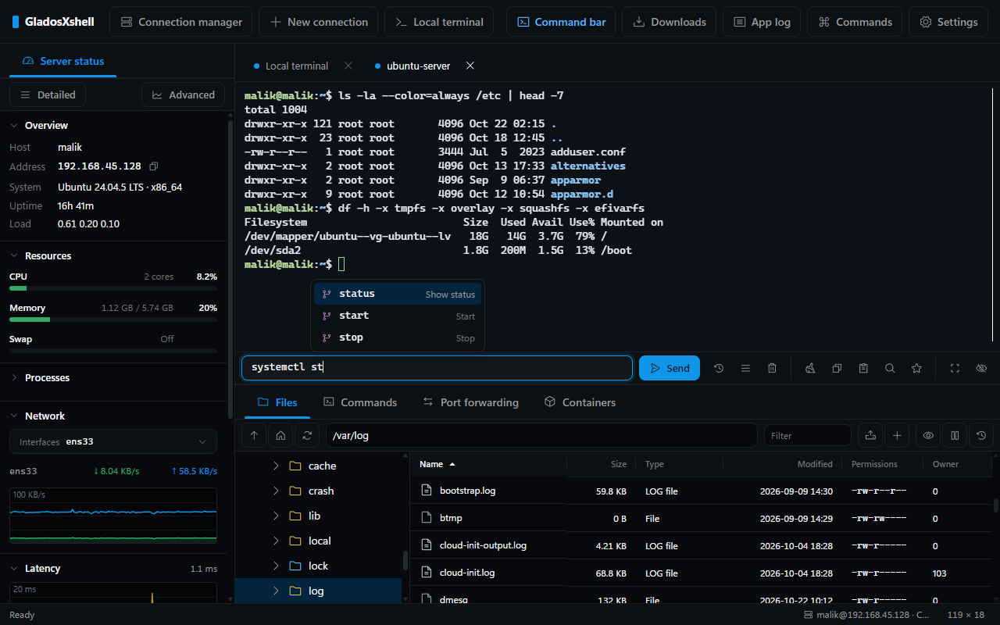
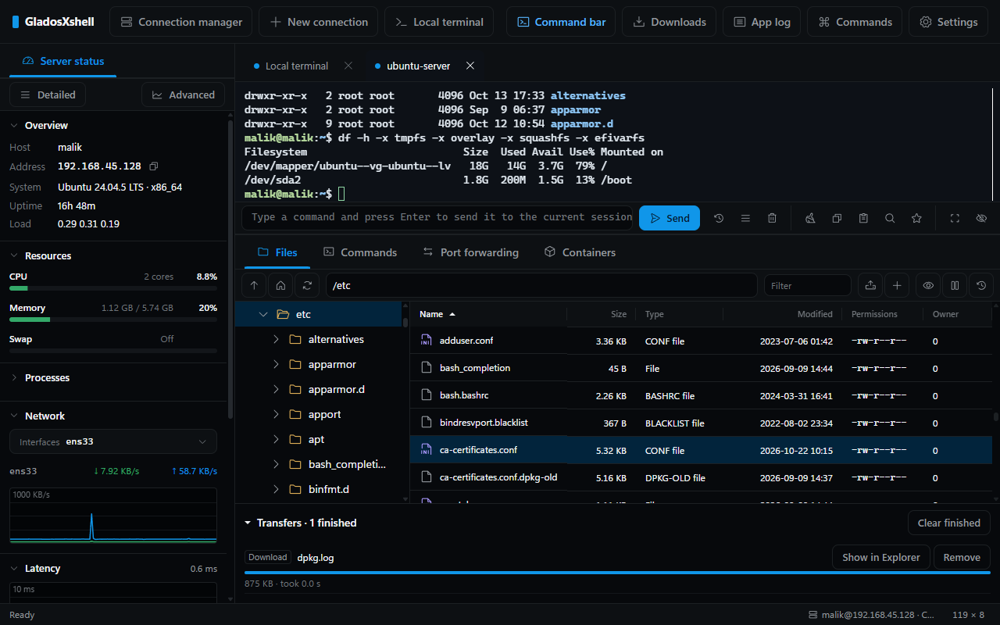
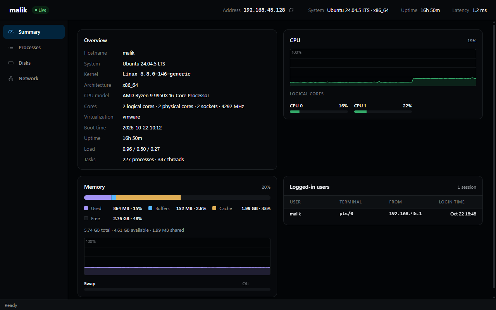

<div align="center" dir="rtl">


# GladosXshell

**Windows ئۈچۈن SSH خېرىدار پروگراممىسى: تېرمىنال، ھۆججەت، مۇلازىمېتىر ھالىتى ۋە ئېغىز يوللاش بىر كۆزنەكتە.**


[English](README.md) · [简体中文](README.zh-CN.md) · ئۇيغۇرچە

<picture>
  <source media="(prefers-color-scheme: light)" srcset="docs/screenshots/main-light.png">
  
</picture>

</div>

<div dir="rtl">

## ئالاھىدىلىكلەر

- **پۈتۈن مۇلازىمېتىر بىر يەردە:** تېرمىنال، SFTP ھۆججەت، جانلىق ھالەت ۋە ئېغىز يوللاش يانمۇيان تۇرىدۇ. كۆڭۈلدىكى ئورۇنلاشتۇرۇش FinalShell غا يېقىن، تاختىلارنى ئوخشىمىغان رايونلارغا يۆتكىگىلى بولىدۇ.
- **قوراللارنى تونۇيدىغان بۇيرۇق بالدىقى:** تېرمىنالنىڭ ئاستىدا كىرگۈزىسىز. دائىملىق بۇيرۇقلارنىڭ تارماق بۇيرۇقلىرى، پارامېتىرلىرى ۋە يىراقتىكى يوللار تولۇقلىنىدۇ. بىر كىرگۈزۈشنى بىر نەچچە تېرمىنالغا تەڭ ئەۋەتكىلىمۇ بولىدۇ.
- **يىراقتىكى ھۆججەتنى بىۋاسىتە تەھرىرلەش:** ئىچكى تەھرىرلىگۈچتە گرامماتىكا رەڭلەش، ئىزدەش ۋە ئالماشتۇرۇش بار. ھۆججەت تاختىسى تېرمىنالنىڭ نۆۋەتتىكى قىسقۇچىغا ئەگىشىدۇ.
- **جانلىق كۆزىتىش:** CPU، ئىچكى ساقلىغۇچ، دىسكا، تور، كېچىكىش ۋە جەريانلار. ئۇنىڭدىن باشقا، دىئاگرامما ۋە جەريان باشقۇرۇش بار ئايرىم كۆزنەك.
- **مەخپىي ئۇچۇر ئۆز كومپيۇتېرىڭىزدا قالىدۇ:** ئۇلىنىش، ئاچقۇچ ۋە ئىملارنى Rust يادروسى بىر تەرەپ قىلىدۇ. ساقلانغان ئىملار Windows DPAPI بىلەن مەخپىيلەشتۈرۈلىدۇ. ئاساسىي ئىم بەلگىلىسىڭىز، ئۇنىڭ بىلەن مەخپىيلەشتۈرۈلىدۇ.
- **كېڭەيتكىلى بولىدۇ:** ھەربىر ئىچكى ئىقتىدار ئۆزى بىر قىستۇرما، ئايرىم چەكلىگىلى بولىدۇ. ئۈچىنچى تەرەپ قىستۇرمىلىرى ئايرىۋېتىلگەن مۇھىتتا ئىجرا بولىدۇ ۋە سىز رۇخسەت قىلغان ھوقۇقلارنىلا ئىشلىتىدۇ.
- **ئۈچ تىل:** ئىنگلىزچە (`en`)، خەنزۇچە (`zh-cn`) ۋە ئۇيغۇرچە (`ug`). ئۇيغۇرچىدا پۈتۈن كۆرۈنمە يۈز ئوڭدىن سولغا تىزىلىدۇ.

## تېز باشلاش

1. [Releases](../../releases) تىن `GladosXshell-Setup-<نەشر>.exe` نى چۈشۈرۈڭ.
2. ئۇنى ئىجرا قىلىپ، نۆۋەتتىكى ئىشلەتكۈچىگە ياكى بارلىق ئىشلەتكۈچىلەرگە ئورنىتىشنى تاللاڭ.
3. <bdi>`Ctrl+Shift+N`</bdi> بىلەن ئۇلىنىش باشقۇرغۇچنى ئېچىپ، مۇلازىمېتىر قوشۇڭ ياكى <bdi>`~/.ssh/config`</bdi>، Xshell، PuTTY، FinalShell دىن ئۇلىنىش ئەكىرىڭ.

سىستېما تەلىپى: 64 بىتلىق Windows 10 / 11 ۋە WebView2 ئىجرا مۇھىتى. Windows 11 ۋە يېڭىراق Windows 10 دا ئۇ بار.

| مەشغۇلات | كۇنۇپكا |
|---|---|
| بۇيرۇق تاختىسى | <bdi>`Ctrl+Shift+P`</bdi> |
| ئۇلىنىش باشقۇرغۇچ | <bdi>`Ctrl+Shift+N`</bdi> |
| تەڭشەك | <bdi>`Ctrl+,`</bdi> |

## سۈرەتلەر

| ھۆججەت باشقۇرۇش | مۇلازىمېتىر ھالىتى |
|---|---|
|  |  |

## ئىقتىدارلار

**ئۇلىنىش**
- SSH: ئىم، شەخسىي ئاچقۇچ، كۇنۇپكا تاختىسى ئارقىلىق ۋە ssh-agent / Pageant بىلەن كىرىش.
- Telnet ۋە تەرتىپلىك ئېغىز.
- ئۆتكۈنچى مۇلازىمېتىر، SOCKS5 ۋە HTTP ۋاكالەتچى.
- تۇنجى ئۇلانغاندا ئاساسىي ماشىنىنىڭ بارماق ئىزى تەكشۈرۈلىدۇ ۋە ئېسىدە قالىدۇ.
- <bdi>`~/.ssh/config`</bdi>، Xshell، PuTTY ۋە FinalShell دىن ئۇلىنىش ئەكىرگىلى بولىدۇ.
- يەرلىك تېرمىنال: cmd، PowerShell، Git Bash ۋە WSL تارقىتىلمىلىرىنى ئۆزى تاپىدۇ. تېرمىنالنى بۆلگىلى بولىدۇ.

**ھۆججەت**
- SFTP ئارقىلىق كۆرۈش، يۈكلەش ۋە چۈشۈرۈش، يەتكۈزۈش ئۆچىرىكى بىلەن.
- ZMODEM (<bdi>`rz` / `sz`</bdi>).
- يىراقتىكى ھۆججەتلەر ئۈچۈن ئىچكى تەھرىرلىگۈچ.

**مۇلازىمېتىر قوراللىرى**
- ھالەت تاختىسى، جەريان باشقۇرۇش بار ئالىي ھالەت كۆزنىكى.
- ئېغىز يوللاش: ھەر ئەڭگىمىنىڭ يوللاشلىرى ۋە ئېقىمىنى كۆرسىتىدۇ. <bdi>`-L`</bdi>، <bdi>`-R`</bdi> ياكى <bdi>`-D`</bdi> يوللاشنى ۋاقتىنچە قوشقىلى بولىدۇ.
- نۆۋەتتىكى مۇلازىمېتىردىكى Docker قاچىلىرى ۋە Kubernetes Pod لىرى.

**تېرمىنال ياردەمچىلىرى**
- «بۇيرۇقلار» تاختىسى: يىغىلغان بۇيرۇقلارنى قىسقۇچلارغا ئايرىپ ساقلايدۇ.
- ماكرو: بىر قاتار كىرگۈزۈشنى قايتا قويىدۇ. ئارىدا مەلۇم چىقىرىشنى كۈتۈپ تۇرغۇزغىلى بولىدۇ.
- قوزغاتقۇچ: چىقىرىش ماس كەلگەندە گەۋدىلەندۈرىدۇ، ئەسكەرتىدۇ ياكى ئاپتوماتىك جاۋاب قايتۇرىدۇ.
- ئەڭگىمىنى asciicast فورماتىدا خاتىرىلەش ۋە قايتا قويۇش.
- خاتىرە گەۋدىلەندۈرۈش.

**ئاچقۇچ ۋە سانلىق مەلۇمات**
- ئاچقۇچ ئامبىرى: SSH ئاچقۇچى ھاسىل قىلىدۇ ۋە ئەكىرىدۇ. ئاممىۋى ئاچقۇچنى بىر قەدەمدىلا مۇلازىمېتىرغا ئورنىتىدۇ.
- ئىختىيارى ئاساسىي ئىم.
- تەڭشەك ۋە ئۇلىنىشلارنى ئىم بىلەن قوغدالغان زاپاس قىلىپ چىقارغىلى بولىدۇ.
- ئېلىپ يۈرۈشچان ھالەت: `gladosxshell.exe` نىڭ يېنىدا `data` قىسقۇچى قۇرسىڭىزلا بولىدۇ. ئۇنداق بولمىسا سانلىق مەلۇمات <bdi>`%USERPROFILE%\.gladosxshell`</bdi> دا ساقلىنىدۇ.

**كۆرۈنۈش**
- ئۈچ خىل ئورۇنلاشتۇرۇش.
- قېنىق ۋە سۇس ئۆرنەك.
- تېرمىنال خەت نۇسخىسى، تەگلىك رەسىمى ۋە ئىختىيارى CSS.
- كۆرۈنمە يۈز تىلى ئايرىم «تىل» تەڭشىكىدە تاللىنىدۇ (كۆرۈنۈش بىلەن قىستۇرما ئارىسىدىكى ئايرىم تەڭشەك) ۋە قايتا قوزغالغاندىن كېيىن كۈچكە ئىگە بولىدۇ.

## قىستۇرما

قىستۇرمىلار JavaScript دا يېزىلىدۇ ۋە ئايرىۋېتىلگەن iframe دا ئىجرا بولىدۇ. ئۇلار ئەپكە پەقەت `gx` API ئارقىلىق، ئىشلەتكۈچى رۇخسەت قىلغان ھوقۇقلار بىلەنلا مۇراجىئەت قىلالايدۇ. قىستۇرما قوشالايدىغان نەرسىلەر:
- بۇيرۇق، تىزىملىك تۈرى ۋە تېزلەتمە كۇنۇپكا
- تاختا ۋە ھالەت بالدىقى تۈرى
- تەڭشەك، ئۆرنەك ۋە تولۇقلاش سانلىق مەلۇماتى

| ماتېرىيال | ئورنى |
|---|---|
| قوللانما | ئەپ ئىچىدە: بۇيرۇق تاختىسى ← «قىستۇرما ئېچىش قوللانمىسى» |
| تىپ ئېنىقلىمىلىرى | [`sdk/gx.d.ts`](sdk/gx.d.ts) |
| مىساللار | [`examples/plugins`](examples/plugins): `hello` (بۇيرۇق، تىزىملىك، تاختا) ۋە `disk-alert` (`df` نى ئىجرا قىلىپ، ھالەت بالدىقىدا ئاگاھلاندۇرىدۇ) |
| تەرجىمە | `plugin.json` دىكى `locales`؛ كۆرۈنمە يۈز تىلى `gx.lang` دىن ئوقۇلىدۇ |

## مەنبە كودىدىن قۇرۇش

Node.js ۋە مۇقىم نەشرىدىكى Rust (edition 2024) كېرەك.

</div>

```sh
npm install
npm run tauri dev        # ئېچىش ھالىتىدە ئىجرا قىلىش
npm run check            # Biome، TypeScript، Vitest ۋە تەرجىمە قىلىنمىغان تېكىست تەكشۈرۈش
cargo clippy --workspace --all-targets -- -D warnings
cargo test --workspace
npm run build:release    # رەسمىي نەشر ئورناتقۇچى
npm run build:debug      # سىناق نەشرى ئورناتقۇچى: ئاچقۇچىلار قورالى بار، سانلىق مەلۇمات ئايرىم ساقلىنىدۇ
```

<div dir="rtl">

ئورناتقۇچلار <bdi>`target/release/setup/`</bdi> قىسقۇچىغا چىقىرىلىدۇ.

| قىسقۇچ | مەزمۇنى |
|---|---|
| <bdi>`src/`</bdi> | ئالدى ئۇچ (TypeScript، Vite، xterm.js، CodeMirror) |
| <bdi>`crates/gxs-core/`</bdi> | ئۇلىنىش، دەلىللەش، سانلىق مەلۇمات ۋە ئاچقۇچ (Rust) |
| <bdi>`src-tauri/`</bdi> | ئەپ قېپى (Tauri 2) |
| <bdi>`installer/`</bdi> | ئورناتقۇچ |

يېڭى قوشۇلغان ھەربىر كۆرۈنمە يۈز تېكىستىنىڭ `zh`، `en` ۋە `ug` نۇسخىسى بولۇشى كېرەك. تەرجىمە قىلىنمىغان تېكىست بولسا `npm run check` خاتالىق بېرىدۇ.

## سۇپا

| سۇپا | ھالىتى |
|---|---|
| Windows 10 / 11، x64 | قوللايدۇ |
| Linux | تېخى ياق. كودتا Linux تارمىقى بار، ئەمما تېخى قۇرۇلۇپ سىنالمىدى |
| macOS | تېخى ياق |

Linux ۋە macOS تا ئاساسىي ئىم بەلگىلەنمىگەندە ئىم ساقلاش ئۈچۈن سىستېما ئاچقۇچ ساندۇقىغا ئۇلاش كېرەك.

## پىكىر-تەكلىپ

مەسىلە كۆرۈلسە، «تەڭشەك ← سىناق» تا دىئاگنوز بولىقىنى چىقىرىڭ ۋە مەسىلىنىڭ قىسقىچە چۈشەندۈرۈلۈشى بىلەن بىللە <bdi>malik6@qq.com</bdi> غا ئەۋەتىڭ.

</div>
